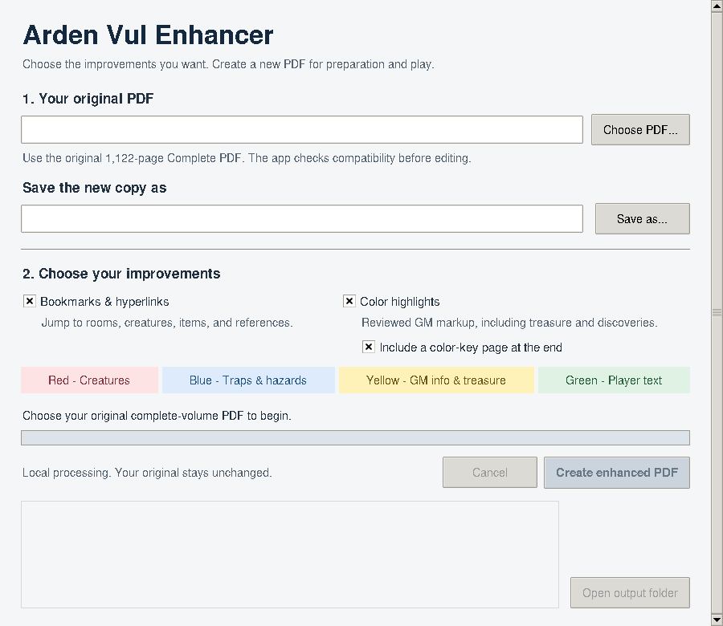

# Arden Vul Enhancer

A small desktop tool that adds reviewed navigation and GM color highlights to **your own original copy of The Halls of Arden Vul Complete**.

Choose one of three results:

| Choice | What the new PDF receives |
| --- | --- |
| Navigation only | Updated bookmarks and 44,338 clickable cross-references |
| Highlights only | 19,890 reviewed color highlights, with an optional color-key page |
| Both | The navigation updates and the highlights together |

The app works locally. Your PDF is not uploaded. It saves a separate output file and leaves the original alone. It does not require an AI subscription, API key, or online service to process the book.



## Get started

### Easiest: download a desktop app

1. Open this repository's **Releases** section and download the ZIP for your operating system.
2. Extract the **entire ZIP** before running it.
3. Open **Arden-Vul-Enhancer.exe** on Windows, **Arden-Vul-Enhancer.app** on macOS, or **Arden-Vul-Enhancer** on Linux.
4. Choose your original PDF, select the updates, and choose where to save the new copy.
5. Click the create button and wait for completion.

The desktop downloads include Python and the required library. You do not have to install Python separately. Windows and Linux packages contain a supporting `_internal` folder: keep it with the executable.

**If there is no Release yet:** use the source launchers below, or follow [the GitHub publishing guide](docs/GITHUB_GUIDE.md) to generate the desktop downloads.

### Run the source project

Install [Python](https://www.python.org/downloads/) first; Python **3.12** is recommended, and **3.10 or later** is required. Extract this source project to a normal writable folder.

| System | Launcher |
| --- | --- |
| Windows | Double-click `Start-Windows.bat` |
| macOS | Run `Start-macOS.command` |
| Linux | Run `Start-Linux.sh` |

The launcher creates a private `.venv` folder and installs the pinned dependency there on first use. That first setup needs an internet connection. PDF processing afterward is local and can work offline. See [the user guide](docs/USER_GUIDE.md) for platform-specific details and troubleshooting.

## Which PDF does it support?

This release supports the **complete, 1,122-page source layout used for this edition of the patch**. It checks the document's text and its placement before adding coordinates. Matching books with additional separate vendor watermark lines can be accepted when the original book text and positions are unchanged. Renaming a file is fine.

Scans, reflowed PDFs, differently paginated editions, and the individual-volume PDFs are not supported by this patch. Use the original book as input. If the compatibility check rejects a copy, the app explains the mismatch and does not apply misplaced marks.

## Validation

All three modes were tested against the supported complete book. Checks covered every original page and every generated navigation or highlight entry, and the original PDF remained unchanged. Eleven synthetic regression tests and a clean local Linux desktop build also passed. See [the validation record](docs/VALIDATION.md) for exact counts and platform testing status.

## Highlight colors

| Color | Meaning |
| --- | --- |
| Red | Monsters, NPCs, and encounter occupants, including conditional encounters |
| Blue | Traps, hazardous interactions, curses, and relevant trigger/effect details |
| Yellow | Important GM information, treasure, discoverable items, keys, maps, documents, clues, and operating instructions |
| Green | Player-shareable descriptions, inscriptions, dialogue, and rumors when available to the characters |

Highlights have **no comment text or attached pop-up notes**. Green text still follows the book's visibility, language, discovery, and encounter conditions. Rumors retain their authored uncertainty. When selected, the color key is appended after the original book, so original page positions stay the same.

## Command-line use

After installing the dependency with `python -m pip install -r requirements.txt`:

```bash
# Check a copy without creating a PDF.
python -m arden_vul_enhancer "My original book.pdf" --check

# Create both sets of improvements.
python -m arden_vul_enhancer "My original book.pdf" "My enhanced book.pdf" --mode both

# Create navigation only.
python -m arden_vul_enhancer "My original book.pdf" "My linked book.pdf" --mode navigation

# Create highlights without adding a key page.
python -m arden_vul_enhancer "My original book.pdf" "My highlighted book.pdf" --mode highlights --no-color-key

# See all options.
python -m arden_vul_enhancer --help
```

Use `py` instead of `python` on Windows if that is how your Python installation is launched. The GUI opens when the module is run without arguments.

## What is in this repository?

- The desktop interface and a command-line interface.
- A small compressed patch containing coordinates, colors, destinations, structural instructions, and compatibility fingerprints.
- Source launchers and a GitHub Actions workflow for building desktop downloads.
- [Instructions for users](docs/USER_GUIDE.md), [step-by-step GitHub instructions](docs/GITHUB_GUIDE.md), and [contributor notes](CONTRIBUTING.md).

**The commercial PDF, artwork, and extracted adventure prose are not included.** Bookmark labels that come from the book are obtained from the owner's input copy. The original or resulting PDF should not be committed to this repository or included in release downloads.

## Build desktop downloads

GitHub can build the Windows, Apple-silicon Mac, Intel Mac, and Linux packages using the included **Build desktop downloads** workflow. No book PDF is required for a build.

For a local build on the target operating system:

```bash
python -m pip install -r requirements-build.txt
python tools/build_desktop.py
```

The output is a ZIP in `release/`. PyInstaller builds for the operating system on which it runs, which is why the workflow uses separate native runners. See [PyInstaller's operating-mode documentation](https://github.com/pyinstaller/pyinstaller/blob/develop/doc/operating-mode.rst).

The project includes the build recipe; a successful build on your repository is what produces its desktop download. Windows and macOS builds are not signed or notarized by this project. See the user guide if the operating system asks you to review a downloaded application.

## License and attribution

Copyright (C) 2026 Arden Vul Enhancer contributors.

The program code and original patch instructions are licensed under **AGPL-3.0-or-later**. See [LICENSE](LICENSE) and [THIRD_PARTY_NOTICES.md](THIRD_PARTY_NOTICES.md). PyMuPDF/MuPDF retain their own licensing terms. This license does not apply to The Halls of Arden Vul, its artwork, prose, or other publisher-owned material.

This is an unofficial community utility, not a publication of or endorsement by the book's authors or publisher.
